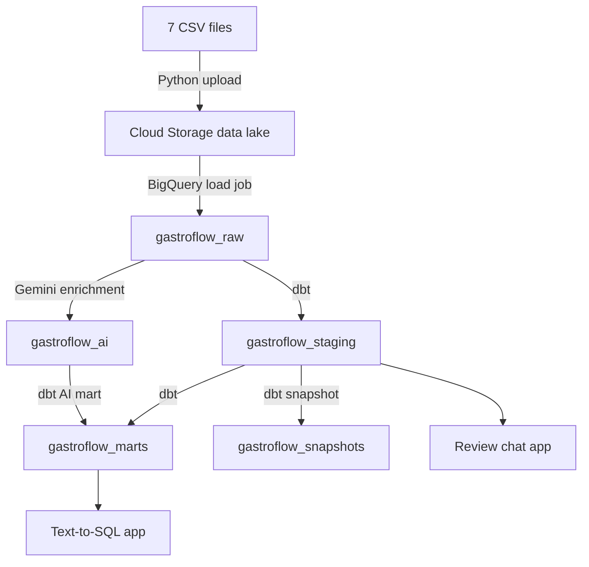

# GastroFlow AI Data Platform

An end-to-end restaurant data platform on Google Cloud. It turns seven CSV files
into analytics tables, then adds AI features: review enrichment, text-to-SQL and
a review chatbot (RAG).

**Stack:** Python · Cloud Storage · BigQuery · dbt · Airflow (Cloud Composer) ·
Terraform · Gemini API · Streamlit

## Contents

- [Overview](#overview)
- [Architecture](#architecture)
- [Data model](#data-model)
- [Project structure](#project-structure)
- [Getting started](#getting-started)
- [Run on Cloud Composer](#run-on-cloud-composer)
- [AI features](#ai-features)
- [Costs](#costs)
- [Tests](#tests)
- [Troubleshooting](#troubleshooting)
- [Limitations and security](#limitations-and-security)

## Overview

Restaurant activity is spread across separate files: restaurants, menus, food,
users, orders, order items and reviews. GastroFlow brings them together to follow
sales, restaurant performance, deliveries and customer feedback.

| Layer | What it does |
|---|---|
| Collect | Uploads the CSV files to Cloud Storage and loads them into BigQuery |
| Transform | Cleans and models the data with dbt |
| Orchestrate | Runs the pipeline with Airflow on Cloud Composer |
| AI | Labels reviews, answers data questions and chats with reviews |
| Infrastructure | Creates the Google Cloud resources with Terraform |

## Architecture



The layers follow a Medallion-like pattern: **raw** (Bronze), **staging**
(Silver) and **marts** (Gold).

## Data model

**Raw:** every column is loaded as `STRING`. Each load **replaces** the table.

**Staging:** views that clean and prepare the raw data.

**Marts:** a star-style model.

| Type | Models |
|---|---|
| Dimensions | `dim_customers`, `dim_restaurants`, `dim_food`, `dim_date` |
| Facts (incremental, `merge`) | `fct_orders`, `fct_order_items` |
| Analytics | `mart_daily_city_revenune`, `mart_monthly_city_sales`, `mart_restaurant_performance`, `mart_food_performance`, `mart_customer_order_summary`, `mart_delivery_sla` |
| AI | `mart_review_insights` |

**Snapshots:** `snap_orders` and `snap_restaurants` use the dbt `check` strategy.
They keep an earlier version when a tracked value changes between snapshot runs.

## Project structure

```text
GastroFlow/
├── airflow/
│   ├── dags/
│   │   ├── gastroflow_full_pipeline.py      full pipeline without AI
│   │   └── gastroflow_full_pipline_ai.py    full pipeline with AI
│   └── dbt/profiles.yml.example             used by Composer and local dbt
├── ai/                                      enrichment, Gemini client, SQL checks
├── app/                                     text_to_sql.py, rag_chat.py
├── collect/                                 upload and load code, with tests
├── transformation/                          dbt models, snapshots, tests
├── terraform/                               Google Cloud infrastructure
├── docs/data_dictionary/                    description of the source data
├── .env.example
├── requirements.txt
└── README.md
```

## Getting started

Commands are for **Windows PowerShell**, run from the project's main folder.

### 1. Requirements

- Git, a Python version supported by dbt, Terraform 1.6+ and Google Cloud CLI
- A Google Cloud project with billing enabled, where you can create resources and
  IAM roles
- A Gemini API key from Google AI Studio (only for the AI features)
- The seven source CSV files, which are **not** in this repository

### 2. Clone and install

```powershell
git clone https://github.com/Ilhamelgharbi/GastroFlow-AI-Powered-Restaurant-Data-Platform.git
cd GastroFlow-AI-Powered-Restaurant-Data-Platform
git switch develop

python -m venv .venv
.\.venv\Scripts\Activate.ps1
python -m pip install --upgrade pip
python -m pip install -r requirements.txt -r app/requirements.txt
```

### 3. Prepare Google Cloud

Do this once per project. The state bucket name must be globally unique.

```powershell
$PROJECT_ID = "YOUR_PROJECT_ID"
$REGION = "europe-west1"
$STATE_BUCKET = "$PROJECT_ID-tfstate"

gcloud auth login
gcloud config set project $PROJECT_ID
gcloud auth application-default login
gcloud auth application-default set-quota-project $PROJECT_ID
gcloud services enable serviceusage.googleapis.com cloudresourcemanager.googleapis.com
gcloud storage buckets create "gs://$STATE_BUCKET" --location=$REGION --uniform-bucket-level-access
gcloud storage buckets update "gs://$STATE_BUCKET" --versioning
```

### 4. Configure

You edit two local files. **Neither goes to Git.**

#### `.env` — code on your computer

```powershell
Copy-Item .env.example .env
notepad .env
```

```dotenv
GCP_PROJECT_ID=YOUR_PROJECT_ID
GCP_REGION=europe-west1
GCS_BUCKET=YOUR_PROJECT_ID-gastroflow-lake
GASTROFLOW_AI_MAX_COMMENTS=20
GASTROFLOW_GEMINI_API_KEY=
```

| Variable | Purpose |
|---|---|
| `GCP_PROJECT_ID` | Your Google Cloud project |
| `GCP_REGION` | Region for local dbt |
| `GCS_BUCKET` | Data lake bucket (name built by Terraform) |
| `GASTROFLOW_AI_MAX_COMMENTS` | Maximum distinct comments per enrichment run. Without it, the cap is 2000 |
| `GASTROFLOW_GEMINI_API_KEY` | Key for all Gemini calls |

Dataset names, the `raw/` prefix and model names have defaults.

`dbt` and `ai.enrich_reviews` don't read `.env` by themselves. Load it in **each
new terminal** (values without quotes or end-of-line comments):

```powershell
Get-Content .env | Where-Object { $_ -match '^\s*[^#=]+=' } | ForEach-Object {
  $name, $value = $_ -split '=', 2
  Set-Item -Path "Env:$($name.Trim())" -Value $value.Trim()
}
```

#### `terraform/terraform.tfvars` — infrastructure

```powershell
Copy-Item terraform\terraform.tfvars.example terraform\terraform.tfvars
notepad terraform\terraform.tfvars
```

```hcl
project_id      = "YOUR_PROJECT_ID"
region          = "europe-west1"
prefix          = "gastroflow"   # keep this value: some AI code expects it
force_destroy   = false
enable_composer = false

# Needed when Composer is enabled. Use a version available in your region.
composer_image_version = "composer-3-airflow-2.11.1-build.27"

# Needed only for AI on Composer
gemini_api_key = ""
```

BigQuery, Cloud Storage, dbt and Terraform use your Google sign-in. The API key is
only for Gemini.

### 5. Create the infrastructure

```powershell
terraform -chdir=terraform init -reconfigure -backend-config="bucket=$STATE_BUCKET"
terraform -chdir=terraform plan -out=tfplan
terraform -chdir=terraform apply tfplan
```

Read the plan before applying. With Composer off, it creates the data lake,
BigQuery datasets, service accounts and permissions, and enables the APIs.

> Already deployed? Keep your **existing** state bucket and backend settings.
> Different ones make Terraform think nothing exists.

### 6. Add the data

```text
data/sample/food/food.csv
data/sample/menu/menu.csv
data/sample/restaurants/restaurants.csv
data/sample/users/users.csv
data/sample/reviews/reviews.csv
data/sample/orders/orders.csv
data/sample/order_items/order_items.csv
```

```powershell
python -m collect.upload_to_gcs
```

This replaces files with the same names in Cloud Storage.

### 7. Run the pipeline from your computer

Skip this step if you run the pipeline on Composer.

```powershell
python -m collect.load_to_bigquery

New-Item -ItemType Directory -Force "$HOME\.dbt-gastroflow" | Out-Null
Copy-Item airflow\dbt\profiles.yml.example "$HOME\.dbt-gastroflow\profiles.yml"

dbt debug --project-dir transformation --profiles-dir "$HOME\.dbt-gastroflow"
dbt build --project-dir transformation --profiles-dir "$HOME\.dbt-gastroflow" --select staging marts --exclude tag:ai
dbt snapshot --project-dir transformation --profiles-dir "$HOME\.dbt-gastroflow" --select snap_restaurants snap_orders
```

## Run on Cloud Composer

> **Composer costs money while it exists, even if no DAG runs.**

### Turn it on

1. In `terraform.tfvars`, set `enable_composer = true`.
2. Plan, **read the plan**, then apply:

```powershell
terraform -chdir=terraform plan -out=tfplan
terraform -chdir=terraform apply tfplan
```

3. Check for errors and get the Airflow link:

```powershell
gcloud composer environments run gastroflow-composer --project=$PROJECT_ID --location=europe-west1 dags list-import-errors
terraform -chdir=terraform output composer_airflow_uri
```

4. In the Airflow UI, unpause one DAG and trigger it.

### DAGs

Both are manual. Both start from files **already in Cloud Storage**, and
**replace all seven raw tables**.

| DAG ID | Flow |
|---|---|
| `gastroflow_full_pipeline` | check files → load → staging → marts → snapshots |
| `gastroflow_full_pipeline_ai` | check files → load → staging → marts → Gemini enrichment → AI mart → snapshots |

The file check stops the run if a source file is missing or empty. It doesn't
check that the data is complete.

### AI on Composer

| Setting | Where | Default |
|---|---|---|
| `GASTROFLOW_ENABLE_AI` | `terraform/composer.tf` | `"false"` |
| `GASTROFLOW_AI_MAX_COMMENTS` | `terraform/composer.tf` | `"20"` |
| `gemini_api_key` | `terraform/terraform.tfvars` | empty |

To use AI, add your key, set `GASTROFLOW_ENABLE_AI` to `"true"`, then plan and
apply. With AI off, the enrichment and AI mart tasks print `SKIP`.

### Turn it off

1. Make sure no DAG is running, and save any logs you need.
2. Set `enable_composer = false`.
3. Run `plan` and confirm that **only Composer resources** will be destroyed.
4. Apply, then check that no environment is left:

```powershell
gcloud composer environments list --project=$PROJECT_ID --locations=europe-west1
```

A Composer bucket may remain. Delete only that one; **keep the data lake and
Terraform state buckets**.

## AI features

These run on your computer and don't need Composer. Install the packages, load
`.env`, and build the dbt models first.

### Review enrichment

Adds sentiment, topic and key issue to review comments. Each **distinct** comment
is classified once, and the result is reused for every matching review.

```powershell
python -m ai.enrich_reviews --dry-run     # count and estimate, no Gemini calls
python -m ai.enrich_reviews --limit 20    # classify up to 20 comments
```

Then build the AI mart:

```powershell
dbt build --project-dir transformation --profiles-dir "$HOME\.dbt-gastroflow" --select mart_review_insights --vars '{enable_ai: true}'
```

The AI mart covers only reviews whose comments have been classified. The dry run
still queries BigQuery and creates the cache table if it is missing.

### Text-to-SQL

Ask a question in English. Gemini writes the SQL, basic safety checks run, and
BigQuery executes it on the marts. The app shows the SQL it generated.

```powershell
streamlit run app/text_to_sql.py
```

Example: *Top 10 cities by GMV*

### Review chat (RAG)

Finds the review comments closest to your question and asks Gemini to answer using
them.

```powershell
streamlit run app/rag_chat.py
```

Example: *What are the most common complaints about delivery?*

By default, it searches only the **20 most frequent comments** (`MAX_COMMENTS` in
`app/rag_chat.py`) to keep costs low. Embeddings are saved in
`review_embeddings.parquet`; delete that file after changing the limit or the
reviews.

## Costs

| Source | How to control it |
|---|---|
| Cloud Composer | Turn it off when you finish |
| BigQuery and Cloud Storage | Run pipelines only when needed |
| Gemini enrichment | Dry run first and keep the comment limit low. Retries can add calls |
| Apps | Each question calls Gemini; text-to-SQL also runs a BigQuery query (10 GB billing cap per query by default) |

Set a budget alert in Google Cloud. An alert doesn't stop spending. The Google
Cloud $300 welcome credit doesn't pay for Gemini API usage through AI Studio; see
the [free trial terms](https://docs.cloud.google.com/free/docs/free-cloud-features).

## Tests

```powershell
python -m pytest collect/tests ai/tests
```

One test, which checks the CSV headers, needs the files in `data/sample/`. dbt
data tests run during `dbt build`.

## Troubleshooting

| Problem | What to check |
|---|---|
| `GASTROFLOW_GEMINI_API_KEY is not configured` | Add it to `.env`; for enrichment, load `.env` in the terminal |
| Google credentials error | Run `gcloud auth application-default login` |
| Missing project or bucket variable | Check `.env` and load it again |
| Terraform wants to create resources that exist | Check the state bucket used by `terraform init` |
| DAG not visible | Wait a few minutes, then run `dags list-import-errors` |
| `check_gcs_files` fails | Upload the missing files to `raw/<table>/<table>.csv` |
| Gemini model not found | Check current model names in the Gemini API documentation |
| RAG still uses old comments | Delete `review_embeddings.parquet` |

## Limitations and security

- **Text-to-SQL safety is basic and can be bypassed**, for example by `SELECT *`
  on a table containing emails. Run the app only for yourself. Stronger protection
  needs restricted BigQuery permissions, a table allowlist and no personal data in
  the marts.
- **The Composer API key is not stored in Secret Manager.** It can be read in the
  Terraform state, saved plans and Composer settings.
- **Incremental facts use a timestamp watermark**, so later updates to older
  orders can be missed.
- Raw loads replace tables, DAGs are triggered manually and there is no CI
  pipeline.
- **Use synthetic data only.** The users file has `email` and `password` columns.
- Never commit `.env`, `terraform.tfvars`, plan files, keys or source data.