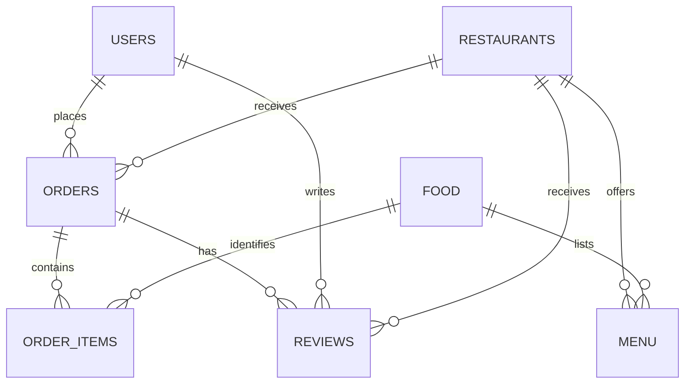

# Audited relationships

The relationships below were checked by matching child identifiers against the
corresponding parent identifiers in the sanitized CSVs.

| Child field | Parent field | Unmatched child rows |
|---|---|---:|
| `orders.user_id` | `users.user_id` | 0 |
| `orders.r_id` | `restaurants.id` | 0 |
| `order_items.order_id` | `orders.order_id` | 0 |
| `order_items.f_id` | `food.f_id` | 0 |
| `menu.r_id` | `restaurants.id` | 273 |
| `menu.f_id` | `food.f_id` | 0 |
| `reviews.order_id` | `orders.order_id` | 0 |
| `reviews.user_id` | `users.user_id` | 0 |
| `reviews.restaurant_id` | `restaurants.id` | 0 |

The diagram shows the intended identifier links, not a claim that every link is
valid: `menu.r_id` has 273 unmatched rows. `menu.menu_id` also has 131,361
duplicate values and is not a verified primary key.

`order_items` has no `menu_id`. Do not assume order-item rows map to menu rows
without an independently validated business key.
